# LOST EMOTIONS

> **2024.08 ~ 2024.11 | 비상업적 취미 팀 프로젝트 | 개발 중단**  
> 팀원들의 개인 사정과 취업으로 프로젝트를 지속하기 어려워 2024년 11월 개발을 중단했습니다. 완성·출시된 게임이 아니며, 당시 구현한 기능과 개발 과정을 기록한 저장소입니다.

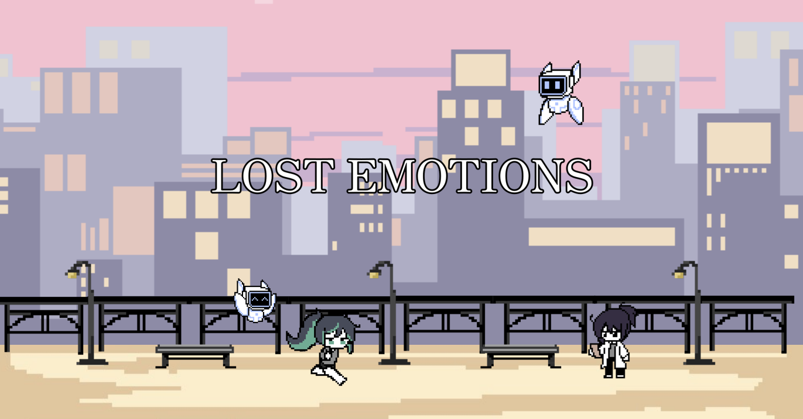

## 프로젝트 소개

LOST EMOTIONS (잃어버린 감정)는 감정을 잃어버린 미래 한국을 배경으로, 주인공이 기억과 감정을 되찾는 이야기를 다룬 2D 스토리 게임입니다. 팀원들이 취미로 모여 개발했으며, 초기에는 [횡스크롤 액션 RPG]를 제작하다가 전투 방식과 몰입도를 재검토하여 [스토리 기반 리듬게임]으로 방향을 변경했습니다.

| 구분 | 내용 |
| --- | --- |
| 기간 | 2024.08 ~ 2024.11 |
| 형태 | 비상업적 취미 팀 프로젝트 |
| 엔진 | Unity 2022.3.40f1 |
| 언어 | C# |
| 협업 분야 | 개발 · 기획 · 캐릭터/배경 디자인 · 음악/효과음 |
| 진행 상태 | 개발 중단 (2024.11) |

## 등장인물 소개

게임의 주요 등장인물과 당시 제작한 콘셉트 아트·도트 애니메이션입니다. 아래 이미지는 팀 프로젝트의 공동 제작 리소스입니다.

### 주인공

기억과 감정을 되찾기 위해 여행하는 18세 소녀, 힘과 정의감이 강하며 감정이 사라진 세계에서 자신의 정체를 찾기 위한 여정을 이어갑니다.

<table>
<tr>
<td align="center">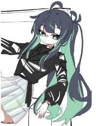 캐릭터 콘셉트</td>
<td align="center">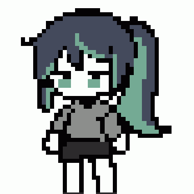 기본 모션</td>
<td align="center">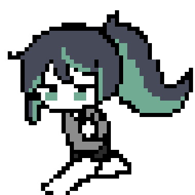 달리기</td>
<td align="center">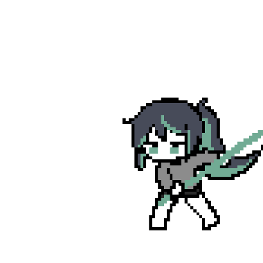 공격 모션</td>
</tr>
</table>

### 하니 박사 — 조력자

연구에 몰두하는 피곤한 인상의 박사입니다. 주인공이 기억을 되찾는 여정에서 연구와 발명품을 통해 도움을 주는 인물입니다.

<table>
<tr>
<td align="center">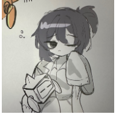 캐릭터 콘셉트</td>
<td align="center">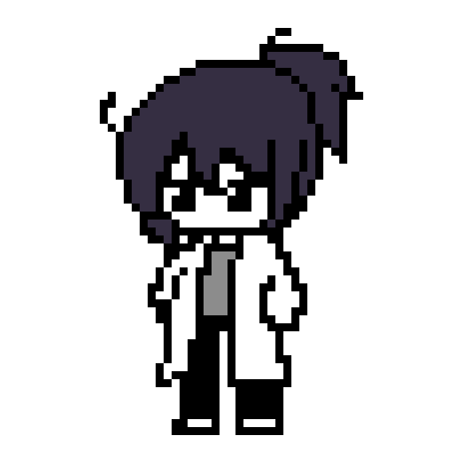 기본 도트</td>
<td align="center">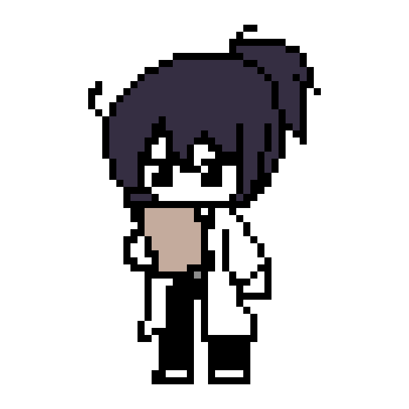 추가 모션</td>
<td align="center">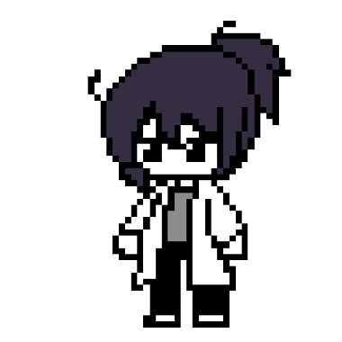 애니메이션</td>
</tr>
</table>

### 아루프 — 조력자의 로봇

하니 박사가 제작한 로봇으로, 게임 세계관상 AI가 탑재된 존재입니다. 연구실에서 하니를 돕고 주인공의 모험에 동행하도록 설정했습니다.

<table>
<tr>
<td align="center">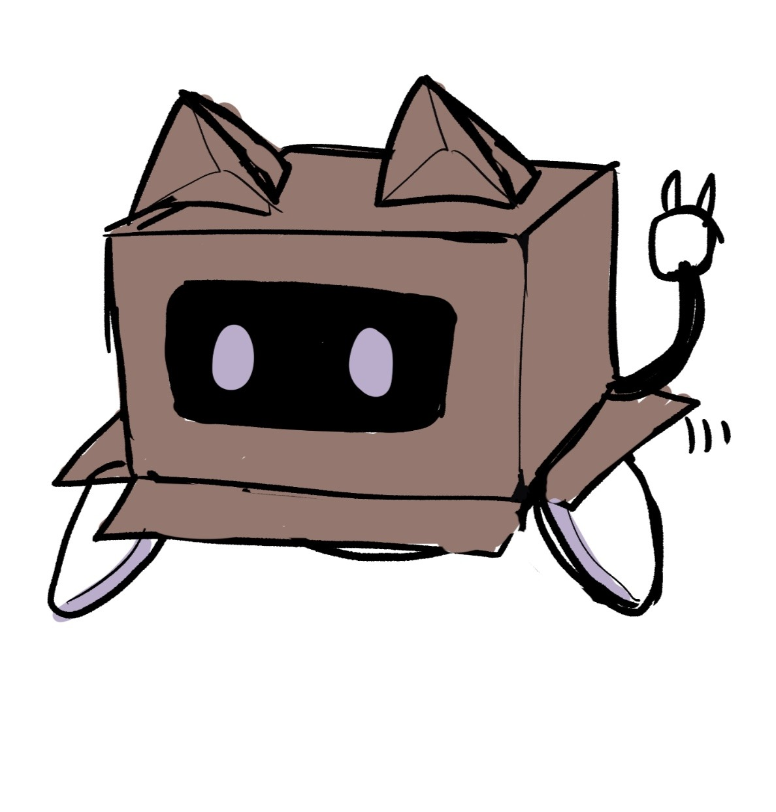 로봇 콘셉트</td>
<td align="center">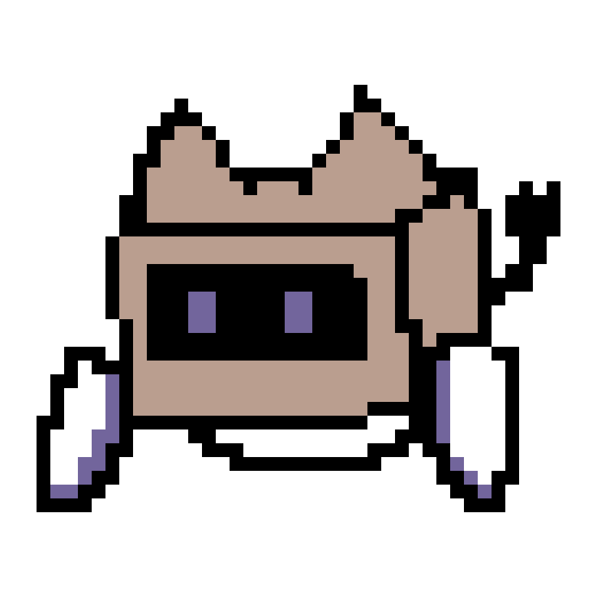 기본 도트</td>
<td align="center">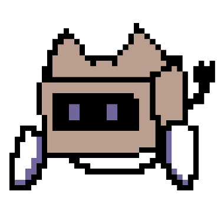 비행 모션</td>
<td align="center">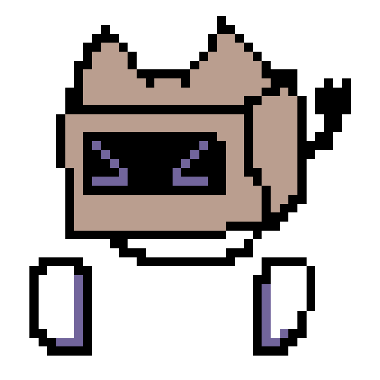 표정 변화</td>
</tr>
</table>

### 몬스터

초기 액션 RPG 개발 단계에서 사용한 몬스터 도트 애니메이션 4종입니다.

<table>
<tr>
<td align="center">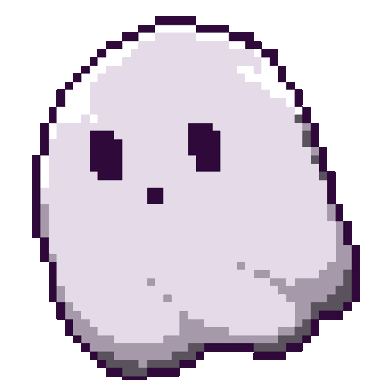</td>
<td align="center">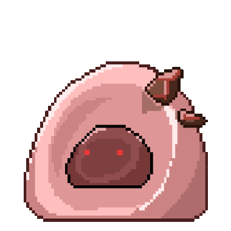</td>
<td align="center">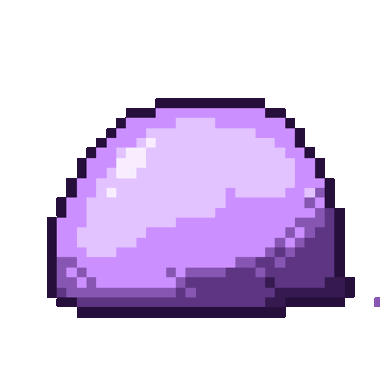</td>
<td align="center">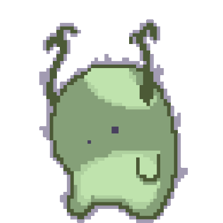</td>
</tr>
</table>

## 시연 영상

[2024년 8월 27일 촬영한 초기 버전의 타이틀·프롤로그 연출 영상]입니다. 캐릭터 이동이나 전투 전체 기능의 시연 영상은 아닙니다.

[▶ 초기 프롤로그 시연 영상 보기 (약 1분)](docs/videos/prologue_demo.mp4)

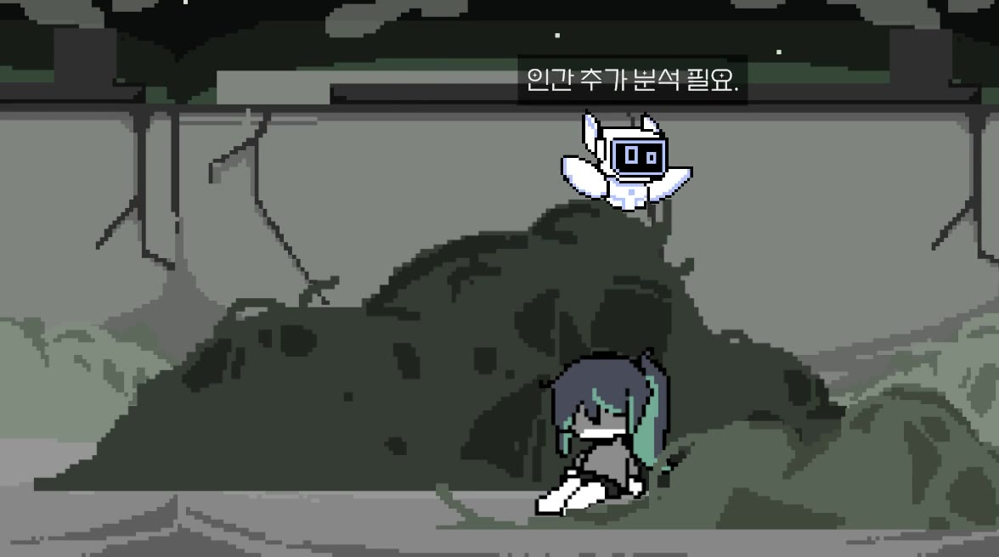

## 담당 업무

팀 프로젝트에서 담당했던 작업을 중심으로 작성했습니다.

- 게임플레이 구현 : Unity C#을 이용한 캐릭터 이동 및 점프 관련 기능 개발
- 게임 환경 구성 : 씬 내 오브젝트 배치와 맵 구성 작업
- 씬·연출 작업 : 프롤로그 및 연구실 장면 구성·수정에 참여

## 저장소에서 확인할 수 있는 주요 구현 코드

| 구분 | 코드 | 확인할 수 있는 내용 |
| --- | --- | --- |
| 캐릭터 조작·전투 | [`playerMove.cs`](Assets/scripts/playerMove.cs) | Rigidbody2D 이동·점프·대시, 애니메이션, 콤보 공격, 피격 처리 |
| 카메라 제어 | [`mainCamera.cs`](Assets/scripts/mainCamera.cs) | 플레이어 추적과 카메라 이동 범위 제한 |
| 배경 스크롤 | [`scrollBackfront.cs`](Assets/scripts/scrollBackfront.cs) | 카메라 방향에 따른 배경 이동과 반복 배치 |
| 대화 연출 | [`ShowDialogueUI.cs`](Assets/scripts/System/Dialogue/ShowDialogueUI.cs) | 인물 이미지·대사 출력과 타이핑 애니메이션 |
| 리듬게임 시제품 | [`NoteManager.cs`](Assets/mainGame/Note/NoteManager.cs), [`TimingManager.cs`](Assets/mainGame/Player/TimingManager.cs) | 노트 생성 및 입력 타이밍 판정의 기초 로직 |

> 위 항목은 소스코드 존재와 구현된 로직을 설명합니다.

## 개발 방향 변경

처음에는 횡스크롤 액션 RPG를 중심으로 진행했으나, 전투의 타격감·조작 경험에 대한 팀 내부 검토를 거쳐 음악과 스토리의 결합에 집중하는 리듬게임으로 방향을 변경했습니다. 이후 노트 생성·판정 로직 및 프롤로그 연출 등을 작업했지만, 여러 사정으로 프로젝트가 중단되었습니다.

## 프로젝트 결과 및 회고

완성된 상용 게임을 출시하지는 못했지만, Unity의 2D 물리 기능과 C# 스크립트, 캐릭터 제어, 씬 구성, 게임 UI·서버 통신 구조를 다루고 팀원들과 개발 방향을 조율한 경험을 얻었습니다.

- 중단 사유 : 2024년 11월 팀원들의 개인 사정 및 취업으로 지속적인 공동 개발이 어려워졌습니다. 이 저장소는 당시의 개발 결과물을 보존하기 위한 것으로, 현재 개발 중인 프로젝트가 아닙니다.

---

*스크린샷과 영상은 개발 당시 자료입니다.*
